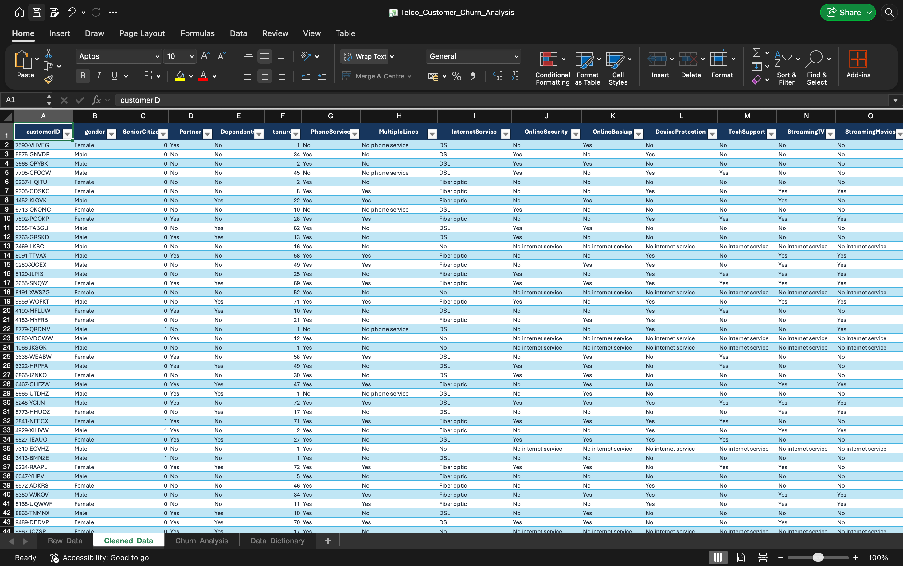
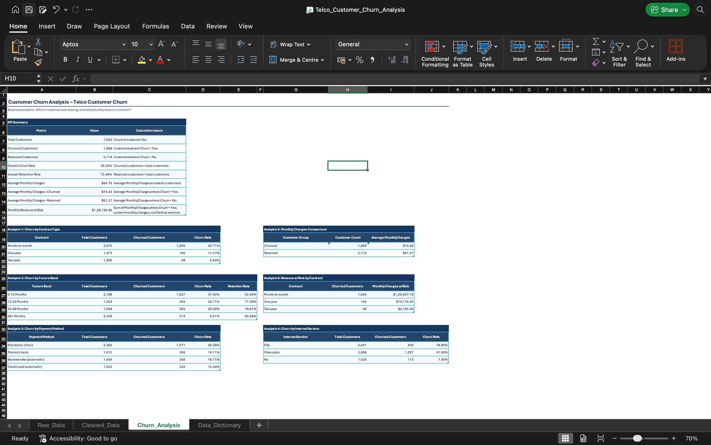
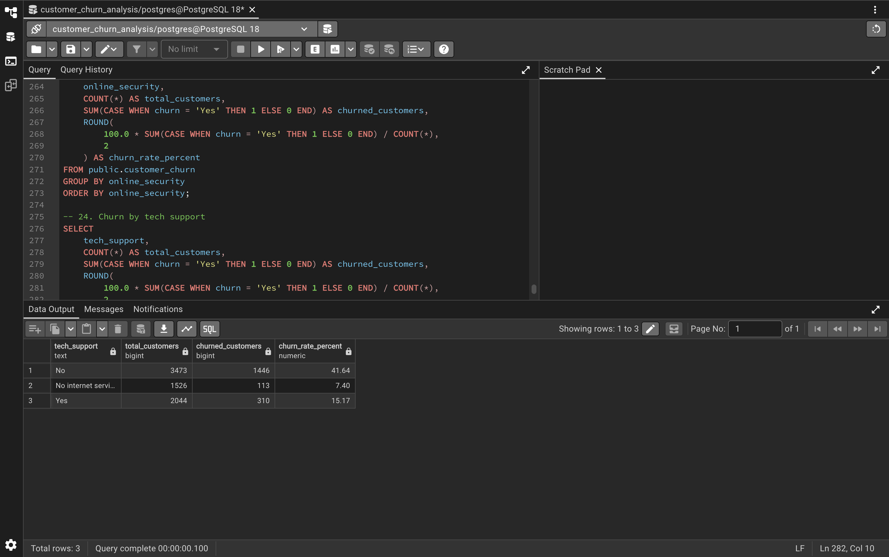
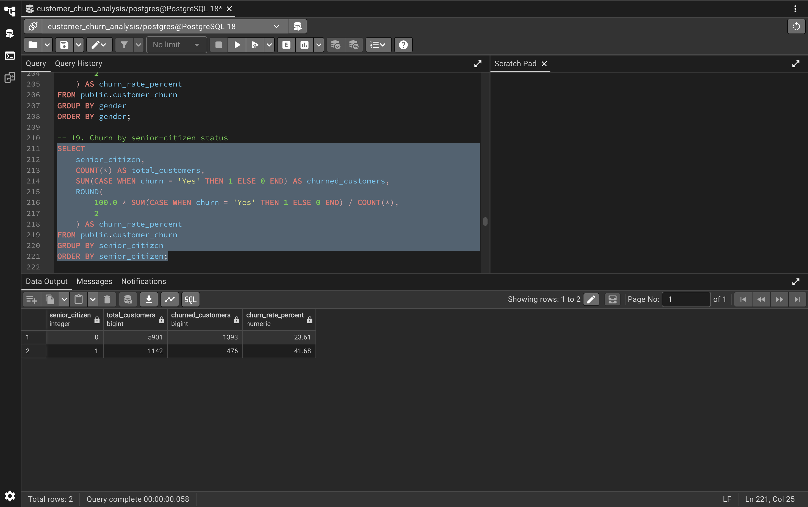
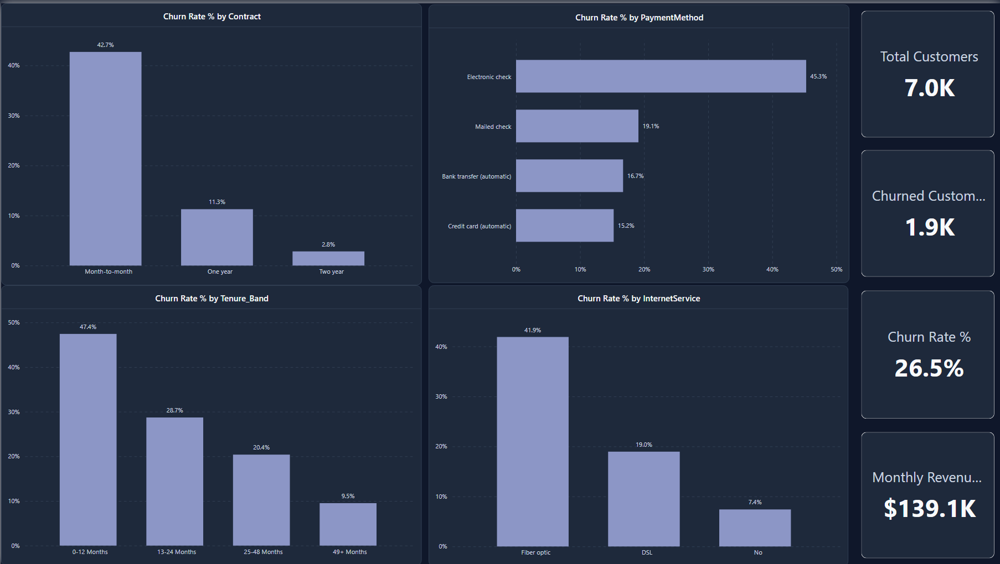

# Telco Customer Churn Analysis

**Who is leaving, and what do they have in common?**

I wanted to work on a question that every subscription business cares about: why do customers leave? Keeping a customer is almost always cheaper than winning a new one, so understanding churn felt like a good problem to practise on.

For this project, I used the Telco Customer Churn dataset, a publicly available sample dataset for a fictional telecom company. It contains customer accounts, the services they use, how they pay and whether they left.

The main goal was to find out which customers are leaving, how much monthly revenue that puts at risk, and what the customers who leave have in common.

This is an independent portfolio project using a publicly available dataset. It is not based on any company's internal data.

## What I wanted to find out

While exploring the dataset, I focused on a few questions:

- How many customers churn, and how much monthly revenue does that put at risk?
- Does the type of contract affect churn?
- When in a customer's life do they tend to leave?
- Do payment method and internet service type make a difference?
- Do certain groups, such as senior citizens or customers without tech support, churn more than others?

## Tools I used

- **Microsoft Excel** – Cleaning the dataset, adding calculated columns, building a formula-backed KPI summary and writing a data dictionary.
- **PostgreSQL** – Checking the data, writing SQL queries and finding patterns.
- **Power BI** – Building a dashboard to present the results visually.

## Working with the data

The dataset contains **7,043 customers** and 21 original columns.

During the initial review, I found 11 customers with a blank `TotalCharges` value. All of them had a tenure of 0 months, meaning they were brand-new customers who had not been billed yet. Rather than removing them, I set their total charges to 0 and documented the change in the data dictionary. There were no duplicate customer IDs.

I also added two columns in Excel:

- `Tenure_Band` – Groups customers into 0-12, 13-24, 25-48 and 49+ months.
- `Churn_Flag` – A numeric version of churn (Yes = 1, No = 0), which makes churn rates easy to calculate.

I kept the original data separate from the cleaned data, and I used SQL to check that every tenure band matched the customer's tenure and every churn flag matched the churn value.

### The headline numbers

| Metric | Value |
|---|---:|
| Total Customers | 7,043 |
| Churned Customers | 1,869 |
| Retained Customers | 5,174 |
| Churn Rate | 26.54% |
| Retention Rate | 73.46% |
| Average Monthly Charges | $64.76 |
| Average Monthly Charges (Churned) | $74.44 |
| Average Monthly Charges (Retained) | $61.27 |
| Monthly Revenue at Risk | $139,130.85 |

Customers who left were paying about $13 more per month, on average, than the customers who stayed.

### A look at the data preparation



### The KPI summary and analysis tables in Excel



## Exploring the data with SQL

Once the cleaned dataset was in PostgreSQL, I wrote a script of 24 numbered queries. The first group checks the data (record counts, missing values, duplicate IDs, tenure bands and churn flags), and the rest work through the questions above.

Here are some of the findings.

### 1. Churn by contract type

| Contract | Customers | Churned | Churn Rate |
|---|---:|---:|---:|
| Month-to-month | 3,875 | 1,655 | 42.71% |
| One year | 1,473 | 166 | 11.27% |
| Two year | 1,695 | 48 | 2.83% |

Contract type was the strongest pattern in the data. About 89% of all customers who churned were on a month-to-month contract.

The same pattern shows up in revenue. Of the $139,130.85 of monthly revenue at risk, **$120,847.10 (about 87%)** comes from month-to-month customers.

### 2. When do customers leave?

| Tenure | Customers | Churned | Churn Rate |
|---|---:|---:|---:|
| 0-12 months | 2,186 | 1,037 | 47.44% |
| 13-24 months | 1,024 | 294 | 28.71% |
| 25-48 months | 1,594 | 325 | 20.39% |
| 49+ months | 2,239 | 213 | 9.51% |

The first year is the danger zone. More than half (55.5%) of all churned customers left within their first 12 months, and the churn rate falls steadily the longer a customer stays. Customers who churned had stayed 18.0 months on average, compared with 37.6 months for those who stayed.

### 3. Payment method

| Payment Method | Customers | Churned | Churn Rate |
|---|---:|---:|---:|
| Electronic check | 2,365 | 1,071 | 45.29% |
| Mailed check | 1,612 | 308 | 19.11% |
| Bank transfer (automatic) | 1,544 | 258 | 16.71% |
| Credit card (automatic) | 1,522 | 232 | 15.24% |

Customers paying by electronic check churned at nearly three times the rate of customers on automatic payments.

### 4. Internet service

| Internet Service | Customers | Churned | Churn Rate |
|---|---:|---:|---:|
| Fiber optic | 3,096 | 1,297 | 41.89% |
| DSL | 2,421 | 459 | 18.96% |
| No internet service | 1,526 | 113 | 7.40% |

Fiber optic customers made up about 69% of everyone who churned. Customers who were on both a month-to-month contract and fiber optic were the riskiest group I found: 2,128 customers, with a churn rate of 54.6%.

### 5. Support services and customer groups

| Group | Customers | Churned | Churn Rate |
|---|---:|---:|---:|
| No tech support | 3,473 | 1,446 | 41.64% |
| Has tech support | 2,044 | 310 | 15.17% |
| No online security | 3,498 | 1,461 | 41.77% |
| Has online security | 2,019 | 295 | 14.61% |
| Senior citizens | 1,142 | 476 | 41.68% |
| Non-senior customers | 5,901 | 1,393 | 23.61% |
| Female | 3,488 | 939 | 26.92% |
| Male | 3,555 | 930 | 26.16% |

Customers without tech support or online security churned at nearly three times the rate of those with them, and senior citizens churned at a much higher rate than other customers. Gender made almost no difference.

### SQL Work Previews





## Building the Power BI dashboard

After the SQL analysis, I moved to Power BI to bring the main findings together in one place.

The dashboard includes four key metrics:

- **Total Customers:** 7,043
- **Churned Customers:** 1,869
- **Churn Rate:** 26.54%
- **Monthly Revenue at Risk:** $139,130.85

It also includes four visualizations:

- Churn rate by contract type
- Churn rate by tenure band
- Churn rate by payment method
- Churn rate by internet service

The numbers on the dashboard match the Excel and SQL results.

The metrics are built with simple DAX measures:

```
Total Customers = COUNTROWS(Telco_Customer_Churn_Cleaned)
Churned Customers = SUM(Telco_Customer_Churn_Cleaned[Churn_Flag])
Churn Rate % = DIVIDE([Churned Customers], [Total Customers])
Monthly Revenue at Risk = CALCULATE(SUM(Telco_Customer_Churn_Cleaned[MonthlyCharges]), Telco_Customer_Churn_Cleaned[Churn] = "Yes")
```

### Dashboard Preview



## What I would suggest to the business

Based on what I found, these are the things I would look at first:

- **Move month-to-month customers onto longer contracts.** A small incentive for choosing a one-year or two-year plan could help protect the revenue at risk.
- **Focus on the first 12 months.** A strong onboarding and check-in process could help with the period when customers are most likely to leave.
- **Encourage automatic payments.** Customers paying by electronic check churn far more than those on automatic payments.
- **Bundle tech support and online security**, especially for fiber optic customers.
- **Look into fiber optic pricing and service quality**, since it has the highest churn of any internet service.

## A few things worth keeping in mind

There are some limitations to this analysis:

- These are patterns, not proof of cause. For example, customers without tech support churn more, but the data can't tell me whether the missing support is the reason.
- The dataset is a single snapshot with no dates, so I can't say how churn has changed over time.
- Monthly Revenue at Risk uses current monthly charges, not lifetime revenue.
- The tenure bands are groupings I chose for this project, not official standards.
- This is a sample dataset for a fictional company, so the findings show the method rather than the performance of a real telecom business.

## Project structure

```
Project_03/
├── Data/
│   ├── Raw/        Telco-Customer-Churn.csv
│   └── Clean/      Telco_Customer_Churn_Cleaned.csv
├── Excel/          Telco_Customer_Churn_Analysis.xlsx
├── SQL/            Telco_Customer_Churn.sql
├── Power_BI/       Telco_Customer_Churn_Dashboard.pbix
└── Images/         Screenshots used in this README
```

## What I learned

This project gave me practical experience working through a complete data analysis workflow, this time around a question that businesses actually care about.

I got to clean and document a dataset in Excel, validate and analyze it using PostgreSQL, and turn the findings into a Power BI dashboard with my own DAX measures.

The biggest lesson was that the most useful finding isn't always the biggest number. Knowing that 26.5% of customers churn is a start, but seeing that month-to-month customers, first-year customers and electronic check payers are where the churn is concentrated is what makes the analysis actionable.

**Thanks for taking a look at my project!**

**Nishant Sahay** · [LinkedIn](https://www.linkedin.com/in/nishant-sahay-0a6229215) · [GitHub](https://github.com/nsahay007) · nishantsahay480@gmail.com
